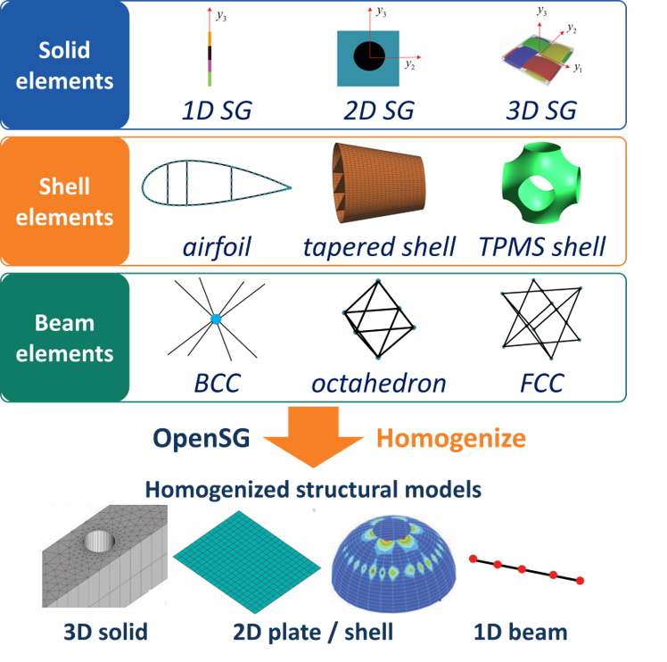

# OpenSG

> **Reviewers:** the version under review is OpenSG 1.0 (FEniCSx), tag [`v1.0.0`](https://github.com/wenbinyugroup/OpenSG/releases/tag/v1.0.0) on branch [`opensg/fenicsx/v1`](https://github.com/wenbinyugroup/OpenSG/tree/opensg/fenicsx/v1). This branch is OpenSG 2.x, the JAX line, which replaces the 1.0 code.

<p align="center"></p>

OpenSG is a multiscale structural-analysis code based on the Mechanics of Structure Genome (MSG), developed by the Multiscale Structural Mechanics Group led by Prof. Wenbin Yu at Purdue University. From a Structure Gene (SG), the smallest building block of a structure, it computes the constitutive relations of solid, plate/shell and beam models (homogenization), and it recovers the local stress, strain and displacement fields from the structural response (dehomogenization).

An SG is a 1-D, 2-D or 3-D finite-element mesh. OpenSG has two engines that share one theory and one command:

| engine | SG | produces |
|---|---|---|
| `opensg_solid` | 1-D, 2-D or 3-D SG of solid elements | plate ABD (6x6) or Reissner-Mindlin (8x8), Timoshenko beam 6x6, equivalent 3-D solid 6x6 |
| `opensg_shell` | 1-D shell SG (cross-section contour), 3-D shell SG (surface) | Timoshenko beam 6x6, equivalent 3-D solid 6x6 |

Both run on JAX, on the CPU or on a GPU.

## Versions

| branch / tag | package | content |
|---|---|---|
| `main`, tags `v2.0.0`, `v2.1.0`, ... | `opensg` 2.x | this code, the JAX line |
| `opensg/fenicsx/v1`, tag `v1.0.0` | `opensg` 1.0.0 | OpenSG 1.0 on FEniCSx (frozen) |
| `opensg/fenicsx/v1.2` | | the later FEniCSx code |

## Installation

Requirements: Linux x86-64 and [conda](https://docs.conda.io) (Miniconda or Miniforge). No GPU is needed.

```bash
git clone https://github.com/wenbinyugroup/OpenSG.git
cd OpenSG
conda env create -f environment.yml
conda activate opensg
```

`environment.yml` installs the conda-forge scientific stack (including the FEniCSx `basix` basis and quadrature library and PETSc), the JAX stack, and the repository itself in editable mode, so the three commands below are on the `PATH`. Pinned versions, the GPU and CPU-only variants, and a plain `pip` route are described in [docs/installation.md](docs/installation.md).

## Running OpenSG

One command, one argument. The yaml says what to do:

```text
opensg <sg.yaml>            homogenization (the default)
opensg <sg.yaml> D          dehomogenization: homogenize, then recover the local fields
opensg <sg.yaml> --center   shell SG only: the contour is the laminate mid-surface instead of the outer mold line
opensg <sg.yaml> --mesh     also draw <base>_mesh.png
opensg --help               every flag, the solver menu and the conversion sub-commands
```

`opensg` reads the yaml's `msg:` key (`shell` or `solid`) and hands the file to the engine that owns it; `opensg_solid <sg.yaml>` and `opensg_shell <sg.yaml>` call the engines directly. A homogenization writes `<base>.out` with the effective stiffness and compliance matrices of the macro model in the SwiftComp `.K` layout. A dehomogenization also writes the local stress, strain and displacement in the material frame as `<base>.SM`, `<base>.EM` and `<base>.U`, and `<base>.vtk` to visualize them.

Meshes from other tools convert to the yaml with `opensg inp_to_yaml <file.inp> --n_model {1,2,3}` (Abaqus), `opensg msh_to_yaml <file.msh> --mat1 NAME --n_model {1,2,3}` (gmsh) and `opensg sc_to_yaml <file.sc>` (SwiftComp).

## Input

One yaml per Structure Gene: a short header, then the mesh. Each engine reads its own dialect:

<table>
<tr><th>SG of shell elements</th><th>SG of solid elements</th></tr>
<tr><td><pre>
msg: shell
n_model: 1          # 1 beam, 2 plate, 3 solid
refined: 1          # 0 classical, 1 shear-refined
nodes:              # node coordinates
elements:           # element connectivity
sets:               # element sets, one per layup
sections:           # one per element set
  - elementSet: layup_0
    layup:          # [material, thickness, angle] per ply
      - [glass_triax, 0.003, 0.0]
      - [glass_uniax, 0.026, 0.0]
elementOrientations:  # material frame per element
materials:          # engineering constants by name
</pre></td>
<td><pre>
msg: solid
n_model: 2          # 1 beam, 2 plate, 3 solid
refined: 1          # 0 classical, 1 shear-refined
nodes:              # node coordinates
cells:              # element connectivity
mat_id:             # material id per element
materials:          # by id
  1:
    type: 1         # engineering constants
    engineering: [E1, E2, E3, G12, G13, G23, nu12, nu13, nu23]
    angle: 45.0     # ply angle
</pre></td></tr>
</table>

The SG dimension (1-D, 2-D or 3-D) is read from the mesh. Every header key is defaulted. The key-by-key reference is [docs/input_format.md](docs/input_format.md).

## Examples

Every example folder holds its input yaml, a short driver script and the `.out` it produces, and runs in place.

- `examples/OpenSG-solid/`: plate properties and stress recovery from a 1-D SG (layup), plate and beam properties and dehomogenization from a 2-D SG (honeycomb unit cell), equivalent solid properties from 2-D and 3-D SGs (unidirectional composite, TPMS lattices).
- `examples/OpenSG_shell/`: beam properties and stress recovery from a blade cross-section of shell elements, equivalent solid properties from shell SGs (cellular, hierarchical and TPMS structures), a tapered segment with aperiodic boundaries, the IEA blade beam, and the full windIO blade pipeline to BeamDyn.
- `examples/pynumad/`: the `opensg.read(blade.yaml)` Blade object for station-by-station blade work.

## Documentation

The Sphinx documentation in `docs/` covers installation, the input format, the constitutive models, the architecture, one tutorial per capability, and the formulation rules under `docs/rules/`. Build it with

```bash
pip install -r docs/requirements.txt
python -m sphinx -b html docs docs/_build
```

A typeset tutorial is included as [docs/latex/opensg_tutorial.pdf](docs/latex/opensg_tutorial.pdf).

## Tests

```bash
pytest tests
```

`tests/unit` exercises the FE core, `tests/msg_k_reference` the solid engine against SwiftComp references, `tests/msg_shell_windio` the shell engine and the blade route, `tests/rm_plate_1D` the Reissner-Mindlin plate chain and `tests/msg_shell_tri3` the shell element kernels.

## Repository layout

```text
src/opensg         the opensg command: dispatches a yaml to its engine, and the Blade entry point
src/opensg_solid   the general 1-D / 2-D / 3-D solid-SG engine, its io conversions and the RM plate chain
src/opensg_shell   the shell-SG engine (contour and surface), its kernels and the blade workflow
src/fe_jax         the finite-element core (see Authors and credit)
docs               Sphinx documentation, rules and the tutorial PDF
examples           runnable examples with their inputs and outputs
tests              pytest suite
```

## Authors and credit

- **Akshat Bagla** (Purdue University): lead developer of OpenSG 2.x (`opensg`, `opensg_shell`, `opensg_solid`), its documentation and tests
- **Wenbin Yu** (Purdue University): the Mechanics of Structure Genome; principal investigator
- **Ernesto Camarena** (Sandia National Laboratories): wind-blade applications and verification
- `fe_jax` by **Keith Ballard** (Air Force Research Laboratory): the finite-element core of [fea-in-jax](https://github.com/KeithBallard/fea-in-jax), which provides the basis and quadrature tables, the periodic assembly map and the matrix-free solvers used by both engines. It is included at `src/fe_jax` so that OpenSG installs as one package; OpenSG is intended to be merged into that repository. Distribution Statement A. Approved for public release: distribution is unlimited. Case #: AFRL-2025-4644.

OpenSG 1.0 (FEniCSx, branch `opensg/fenicsx/v1`, tag `v1.0.0`): code and mechanics: Akshat Bagla; repository, packaging and release engineering: Kirk Bonney (Sandia National Laboratories); with Ernesto Camarena and Wenbin Yu.

Cite OpenSG with the "Cite this repository" button (from `CITATION.cff`).

## License

Apache License 2.0, see [LICENSE](LICENSE).
